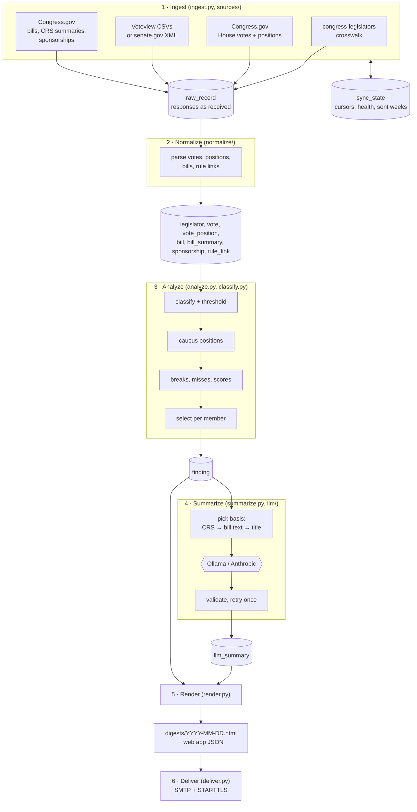

# Developing the Legislator Vote Tracker

This covers running the tracker outside Docker, the command line, the web app's internals, and how each pipeline stage works. For what the app does and how to deploy and use it, see [README.md](README.md).

---

## Local setup

Requires Python 3.12, [uv](https://docs.astral.sh/uv/) and Node (for the UI).

```bash
uv sync                                  # install dependencies into .venv
cp config.example.toml config.toml       # then edit [members] and [http].user_agent
export CONGRESS_GOV_API_KEY=...          # required
export ANTHROPIC_API_KEY=...             # only if llm.provider = "anthropic"
export SMTP_PASSWORD=...                 # only if email.enabled = true

uv run tracker init-db
uv run tracker members                   # check that all three IDs resolve
uv run tracker ingest --since 2025-01-03 # backfill the 119th Congress
uv run tracker normalize
```

Then either run the web app:

```bash
npm --prefix frontend install        # once
npm --prefix frontend run build      # builds the UI into src/tracker/web/static
uv run tracker serve                 # http://127.0.0.1:8000
```

or produce a digest from the command line with `uv run tracker run-weekly`, which analyzes, summarizes and renders last week to `digests/YYYY-MM-DD.html` (named for the week's Monday), then emails it if `[email].enabled` is true.

Secrets are read from the environment at startup and are never shown in the UI or written to `config.toml`.

`config.example.toml` tracks no one (`tracked = []`). Choose members on the Members tab, or list Bioguide IDs in `config.toml`, e.g. Colorado's `["D000197", "B001267", "H000273"]` (Rep. DeGette, CO-1, and Sens. Bennet and Hickenlooper). Bioguide IDs are at <https://bioguide.congress.gov> or in the URL of a member's Congress.gov page. Until members are chosen, the digest is empty and no email is sent: the scheduler holds the weekly slot, and the send endpoint answers 409.

**UI development.** Run `uv run tracker serve` and `npm --prefix frontend run dev` together: Vite serves the UI on `:5173` and proxies `/api` to the server on `:8000`.

---

## Commands

| Command | Does |
| --- | --- |
| `tracker init-db` | Create the database from `schema.sql`; safe to re-run |
| `tracker ingest [--chamber house\|senate] [--since YYYY-MM-DD]` | Stage 1: fetch new and changed records. Both chambers by default; `--since` backfills from a date |
| `tracker normalize [--all]` | Stage 2: parse raw records into tables. `--all` re-parses every raw record, for example after a parser fix |
| `tracker analyze [--week YYYY-MM-DD]` | Stage 3 for the week containing the date. The default is the last full Monday–Sunday week |
| `tracker summarize [--week …]` | Stage 4: LLM summaries for the bills that made that week's digest |
| `tracker digest [--week …] [--send]` | Stages 5 and 6: render the HTML, then email it if `--send` is given and `[email].enabled` is true |
| `tracker run-weekly [--force]` | All stages for the last full week, then send. A week already emailed is not sent again unless `--force` |
| `tracker members` | Show tracked members as resolved: chamber, state, district, Bioguide and LIS IDs, party, caucus |
| `tracker explain-vote <chamber> <session> <roll>` | Print one vote's classification, threshold, caucus positions and per-member score, for tuning. Session is `119-1`, or just `1` |
| `tracker serve [--host 127.0.0.1] [--port 8000]` | Run the web app |
| `tracker dropbox-auth [--app-key KEY]` | Connect a Dropbox app for backups (OAuth with PKCE, so no app secret); prints `DROPBOX_REFRESH_TOKEN` |

Global options are `-c/--config PATH` (default `./config.toml`, or `$TRACKER_CONFIG`) and `-v/--verbose`. In the container, run any of these with `docker exec vote-tracker tracker ...`.

Every command writes a `run_log` row with per-source counts. A command exits non-zero only when a whole stage fails, not when a single record or one chamber's source does.

Logs go to stdout and to a rotating file at `logs/tracker.log`. The Congress.gov key is never logged: it is stripped from every stored URL and from error messages, and httpx's own request logging, which would include it, is silenced.

**Scheduling without the web app.** `tracker serve` schedules its own daily update and weekly email. Without it, use cron. Cron runs with a bare `PATH` and without your shell profile, so use the full path to `uv` and load secrets from a file only you can read:

```cron
15 2 * * *   cd /path/to/political-tracker && . ./.env && /opt/homebrew/bin/uv run tracker ingest && /opt/homebrew/bin/uv run tracker normalize
35 7 * * 6   cd /path/to/political-tracker && . ./.env && /opt/homebrew/bin/uv run tracker run-weekly
```

Here `.env` holds `export CONGRESS_GOV_API_KEY=…` and `export SMTP_PASSWORD=…` lines (`chmod 600 .env`). Cron alongside the web app won't email a week twice: every send is recorded in `sync_state` (`digest_sent:<week>`), and the scheduler, the Admin button and `run-weekly` all check it.

---

## Web app internals

A FastAPI JSON API plus a React single-page app, on top of the same pipeline code as the CLI. Both read the same `config.toml` and database.

- `src/tracker/pipeline.py` holds the stage functions. The CLI and the web app share them, so both write the same `run_log` rows.
- `src/tracker/web/jobs.py` runs background work on a single worker thread, so stages never overlap. A job that is already queued or running is not queued again. When a week is opened, summary jobs for other weeks that haven't started are cancelled, and re-queued if those weeks are opened again. A running job always finishes.
- `src/tracker/web/scheduler.py` runs the daily update, the weekly email and the daily backup. It fires once per scheduled slot, catches up only the most recent missed slot, and never fires for a slot that passed before email was enabled. Backups do run for the latest slot as soon as they are enabled.
- `src/tracker/backup.py` makes and restores backups: a zip of `manifest.json`, `config.toml` and a `VACUUM INTO` snapshot of the database. A restore runs as a job (so it never overlaps a stage) holding the analyze lock. It saves the live database as `<db>.before-restore`, copies the snapshot in with SQLite's backup API (so other threads' connections stay valid), migrates it, writes `config.toml` with this machine's `db_path`, `log_dir` and `output_dir`, and reloads settings. `src/tracker/dropbox.py` is a small httpx client: a token refresh, chunked upload sessions (single uploads are capped at 150 MB), listing and delete. `sync_state` holds `backup:last_ok` and `backup:last_error` for the Admin tab.
- Opening a week runs analyze only when its inputs changed. `sync_state` holds `data_version`, bumped by ingest/normalize, and `analyzed:<week>`, a signature of the data version, tracked members and scoring settings.
- `src/tracker/config_store.py` writes settings back with `tomlkit`. Only lines whose values changed are rewritten, so comments and layout survive, and the previous file is kept as `config.toml.bak`.
- The settings form is generated from the pydantic models' JSON Schema. Two kinds of validation apply: **startup rules** (types, ranges, `HH:MM` times, the time zone, `http(s)` URLs), which the program can't run without, and **readiness rules** for email (a real SMTP host and addresses). Readiness rules block saving and sending, but only log a warning when a config file loads, so a half-finished `[email]` section never locks you out.
- **Finding your members.** The Members tab's "Use my location" button asks the browser for its position (only offered on secure pages: https, or http on localhost) and passes it to `/api/locate`. `sources/census.py` asks the US Census Bureau geocoder for the state and district, rounded to 4 decimal places, and nothing is stored. Each geocoder vintage carries one Congress's district map, and the "Current" vintage moves to the next Congress before it is seated (states redistrict mid-decade too), so vintages are tried until one has `congress.number`'s map. At-large seats and delegates come back as district `0`, as in the crosswalk. With nothing selected, the page fills in the state's senators (first, for delegation splits) and that district's representative, unsaved. On a first visit it locates automatically only if the browser already allows location, so the permission prompt appears only on a click.
- The frontend lives in `frontend/` (Vite + React + TypeScript, no other runtime dependencies) and uses only relative URLs, so the same build works under any `API_PATH`.

**API.** Interactive docs are at `/docs`.

| Endpoint | Purpose |
| --- | --- |
| `GET /api/weeks` | Selectable weeks, newest first, and the default |
| `GET /api/digest/{week}` | Analyze if stale, then return the digest as JSON, with summary progress |
| `GET /api/digest/{week}/email` | The email HTML for that week |
| `POST /api/digest/{week}/summarize`, `POST /api/digest/{week}/send` | Background jobs (send records the week as sent) |
| `GET /api/legislators`, `GET` and `PUT /api/members` | Current members of Congress; the tracked selection (`PUT` needs at least one) |
| `GET /api/locate?lat=&lon=` | State and congressional district at a point, from the Census geocoder (404 outside the US) |
| `GET` and `PUT /api/config`, `POST /api/config/validate` | All settings, their JSON Schema, and which secrets are set; check settings without saving |
| `GET` and `POST /api/jobs`, `GET /api/status` | Jobs and run history; data status |
| `GET /api/backup/export` | Download a backup zip |
| `POST /api/backup/import` | Upload a backup zip as the raw body; it is checked (422 with the reason if not), then restored by a job |
| `POST /api/backup/dropbox` | Back up to Dropbox now (a job) |

**Safety without a login.**
- The server accepts only requests whose `Host` is `127.0.0.1`, `localhost`, or a name in `TRACKER_ALLOWED_HOSTS`, which blocks DNS rebinding.
- Every request that changes something must carry an `X-Tracker-Client` header. A cross-site page can't send it without a CORS preflight, which this app never approves.
- `tracker serve --host` with anything but loopback logs a warning.

**Serving under a path.** With `API_PATH=/tracker`, the UI is at `/tracker/` and the API at `/tracker/api/...`; `/tracker` redirects to `/tracker/`. The app also answers at the root, so a reverse proxy may pass the prefix through or strip it.

**Docker image.** The `Dockerfile` has two stages: a Node stage builds the UI, then a slim Python 3.12 image installs the locked dependencies with uv and copies it in. `.dockerignore` excludes `config.toml`, `tracker.db`, `digests/`, `logs/`, `.env` and `node_modules`. `docker-entrypoint.sh` creates `/data/config.toml` from the example on first run.

---

## Pipeline stages



Each stage is safe to re-run. Stages 1–3 are deterministic and only stage 4 calls an LLM. House and Senate ingest are independent, so a failure in one never blocks the other.

### 1. Ingest (`ingest.py`, `sources/`)

- **Crosswalk.** Downloads [congress-legislators](https://github.com/unitedstates/congress-legislators) `legislators-current.json` when the stored copy is more than 7 days old, then resolves each tracked Bioguide ID to chamber, state, district and LIS ID. If any ID cannot be resolved, ingest stops with a clear error.
- **Members.** Fetches each tracked member, plus their sponsored and cosponsored legislation.
- **House votes.** Lists each session's votes from Congress.gov, then fetches detail and member positions for new votes, meaning those above the roll number stored in `sync_state`.
- **Senate votes.** With `source = "voteview"` (the default), it downloads the Congress's three Senate CSV files (roll calls, positions, members), about 3 MB in total, and queues the bills referenced by new, recent or `--since` votes. With `source = "senate_gov"`, it fetches the session's vote menu XML from senate.gov, then each new vote file.
- **Corrections.** In both chambers, re-fetches every vote from the last 14 days. A payload whose hash has not changed is not normalized again.
- **Bills.** Fetches each bill referenced by a vote, by an amendment vote's target, by a House rule's title, or by a sponsorship, along with its CRS summaries. A bill is re-fetched when it is referenced by something recent, or when the stored copy is more than a week old. Bill text is fetched lazily in stage 4, and only for bills that have no CRS summary.

A failure on one record is logged and skipped, and the run finishes as `partial`. The sync cursor never moves past a failed vote, so that vote is retried on the next run. Every response is stored as received in `raw_record`, so fixing a parser needs only `normalize --all`, not a re-fetch.

The HTTP client (`sources/http.py`) sends the configured User-Agent and limits each host to one request per `min_interval_seconds`. It retries 429 and 5xx responses with exponential backoff, honoring `Retry-After`, and does not retry other 4xx responses.

**senate.gov access.** GET requests to `www.senate.gov` from scripts (Python, curl) get `403 Forbidden` from Akamai's bot protection; HEAD requests succeed, which can make a quick check look fine when it isn't. The tracker does not try to get around the block (no browser spoofing). To test access, use a GET: `curl -s -o /dev/null -w "%{http_code}\n" -A "vote-tracker/0.1 (you@example.com)" https://www.senate.gov/legislative/LIS/roll_call_lists/vote_menu_119_1.xml`.

**Voteview compared with senate.gov.** On the five votes recorded from both sources, everything the tracker uses matches (`tests/test_voteview.py`). Voteview gives each senator's Bioguide ID directly, so there's no LIS-ID lookup. Differences:
- Only dates are published, so votes are dated noon Eastern.
- No tie-breaker field. A 50–50 vote that carried can only have been decided by the Vice President voting yea, so that is recorded; a tied vote that failed records no tie-breaker.
- Nomination numbers lose their dash (PN11-7 becomes PN117), so the digest hides them and shows the nominee description.
- No amendment numbers; amendment votes still link to the bill they amend.
- Rows recording the President's announced position are skipped.

### 2. Normalize (`normalize/`)

- Every member who appears in a vote becomes a `legislator` row. Senators are mapped from LIS ID to Bioguide ID through the crosswalk. An LIS ID with no match is logged once and that member's row is skipped, never invented.
- `party_at_vote` comes from the vote record. `caucus_at_vote` comes from the crosswalk, as of the vote's date, so independents such as Sanders and King are grouped with Democrats, and a member who switches parties is compared with the right group. It falls back to party when the crosswalk has no entry.
- House "Aye"/"No" map to yea/nay. In Senate impeachment trials, "Guilty"/"Not Guilty" map to yea/nay. The original string is always kept in `position_raw`.
- In Speaker elections the House records a candidate's name instead of a position. A vote for the winner is stored as yea and a vote for anyone else as nay, so caucus positions still mean something.
- Bill references such as "H.R. 1234", "S.J.Res. 7" or "H. Con. Res. 14" are parsed. An amendment vote links to the bill it amends. A nomination vote sets `nomination_ref` (for example `PN11-7`) and keeps the Senate's published description, because nominations are not bills.
- A House rule is an H.Res. whose title starts with "Providing for consideration of". Each measure it brings to the floor is written to `rule_link`. Only parenthesized citations such as "the bill (H.R. 3838)" count, so a background reference such as "pursuant to H. Con. Res. 14" is not mistaken for an underlying bill.
- Senate vote times are published in Eastern time and are converted to UTC. All timestamps are stored as ISO 8601 UTC, and converted to the configured time zone only when rendering.
- CRS summaries are stripped of HTML.

### 3. Analyze (`analyze.py`, `classify.py`)

**Classification.** Each vote's question text is matched case-insensitively against a table, per chamber, and the first match wins. The order matters:

| Chamber | Question contains | `vote_class` | Base weight |
| --- | --- | --- | --- |
| Both | "Overriding the Veto", "Veto Message" | `veto_override` | 1.2 |
| Senate | "Guilty or Not Guilty" | `impeachment` | 1.2 |
| House | "Election of the Speaker" | `speaker` | 1.2 |
| Senate | "Cloture" | `cloture` | 0.9 |
| Both | "Table" | `table` | 0.4 |
| House | "Suspend the Rules" | `suspension` | 0.3 |
| Both | "Conference Report", "Concur" (whole word) | `final` | 1.1 |
| Both | "On Passage" | `passage` | 1.0 |
| Senate | "Resolution of Ratification" | `ratification` | 1.0 |
| Senate | "On the Joint/Concurrent Resolution", "On the Resolution" | `passage` | 1.0 |
| House | "Agreeing to the Resolution": a rule H.Res. → `rule`; any other → `passage` | | |
| Senate | "On the Nomination" | `nomination` | 0.8 |
| Both | "Amendment" | `amendment` | 0.6 |
| House | "Ordering the Previous Question" | `rule` | 0.5 |
| Senate | "Motion to Proceed" | `motion_to_proceed` | 0.5 |
| Senate | "Waive", "Point of Order", "Decision of the Chair", "Motion to Discharge/Reconsider/Instruct/Recommit" | `procedural` | 0.5 |
| House | "Recommit" | `recommit` | 0.4 |
| Both | "Adjourn", "Journal", "Quorum", "Call of the House" | `housekeeping` | 0.0 |
| Both | anything else, logged as a warning | `other` | 0.2 |

Cloture is checked first, so cloture on a nomination is `cloture`. "Table" comes before "Amendment", so a motion to table an amendment is `table`. "Suspend the Rules" comes before "Concur", so a suspension motion to concur keeps its two-thirds threshold. "Concur" is matched as a whole word, so "Concurrent Resolution" does not match it.

**Threshold.** This is the share of yea plus nay votes needed to win. For the Senate it comes from `majority_requirement`, which also gets cloture on nominations right: that needs only a simple majority since 2013. For the House it is two-thirds for suspensions and veto overrides, and a simple majority otherwise.

**Caucus position.** For each vote and caucus, only yea and nay are counted. `majority` is the larger side, or none on a tie, and `cohesion = max(yea, nay) / (yea + nay)`.

**Party break.** A tracked member voted yea or nay, against their caucus majority, when that caucus's cohesion was at least 0.80 and at least 5 of its members voted. Breaking from a split caucus is not news.

**Missed vote.** The member's position is `not_voting`. A `present` vote is a deliberate choice and is reported as cast, not as missed. A member with no record on a vote, for example a senator sworn in mid-week, is not counted as missing it.

**Score.** Closeness is measured against the vote's threshold, so a 59–41 cloture vote counts as close and a 59–41 simple-majority vote does not:

```python
yea_share = yea / (yea + nay)
closeness = 1 + (1 - abs(yea_share - threshold) / max(threshold, 1 - threshold))   # 1.0 far … 2.0 on the line
score = base_weight[vote_class] * closeness
score += 1.5 if party_break          # [scoring] party_break_bonus
score += 0.5 if member sponsored or cosponsored the bill (or a rule's underlying bill)
score += 0.5 if the Vice President broke a tie
score += topic_boost.get(bill.policy_area, 0)   # empty by default
```

**Selection** works per member:

- Every party break is included.
- Then the top `top_n` remaining items by score, where several votes on the same bill or nomination (for example cloture and then passage) collapse into one item, ranked by its highest-scoring vote.
- `housekeeping` votes are excluded, and so are lopsided votes (yea share above 0.95 or below 0.05) unless the member sponsored the bill.
- For missed votes, the digest shows a count and lists individually those scoring at least `missed_vote_min_score`. If the tracked representative is the Speaker, who by custom rarely votes, the missed-vote list is replaced with a note saying so.
- Every sponsorship and cosponsorship dated in the week is listed.

**Delegation splits** are computed when the digest is rendered, from stored votes, rather than stored as findings.

Re-running analyze for a week deletes and recreates that week's findings, with identical results.

### 4. Summarize (`summarize.py`, `llm/`)

For each bill attached to a selected finding, using the underlying bill(s) for a House rule vote, the summarizer picks a basis:

1. The latest **CRS summary**.
2. If there is none: the latest **bill text**, HTML stripped and cut to `max_input_chars` at a section boundary where possible.
3. If there is no text either: the **title only**. The LLM is not called, and the digest shows the title with the note "No summary or text published yet".

The model gets the bill number, titles, policy area, a basis label and the basis text, and nothing about votes or members. Its output must match `{"plain_title": str, "what_it_does": [2–4 str], "caveat": str|null}`, validated with pydantic, which enforces at most 12 words in the title and at most 30 in each bullet. Invalid output is retried once, with the validation error appended. If the retry also fails, nothing is stored and the digest shows the first two sentences of the CRS summary instead.

Results are saved in `llm_summary`, keyed by bill, basis, basis version, prompt version and model (`<provider>:<model>`). A summary is regenerated lazily, as bills reappear, when any of these changes: a new CRS version is published, `llm.prompt_version` is bumped, or `llm.provider` / `llm.model` is switched. Summaries from other models are never deleted, so switching back to a model reuses its summaries without calling it again. A bill voted on in both chambers is summarized once. Nominations never reach the model.

| Provider | Implementation |
| --- | --- |
| `ollama` | `POST /api/chat` with the JSON schema as `format`, temperature 0 |
| `anthropic` | The official `anthropic` SDK: Messages API with structured output (`output_config.format` as a JSON schema), `effort: "low"`, and the server-side refusal fallback (`fallbacks: "default"`) on models that support it |

The Anthropic Messages API rejects sampling parameters such as `temperature`, so temperature 0 applies only to Ollama. For Anthropic, repeatability comes from structured output plus the summary cache: a summary is generated once and reused.

The schema sent to Ollama includes `minItems: 2, maxItems: 4` for the bullets. Ollama's constrained decoding enforces those bounds, and without them `llama3.1` returned six bullets twice in a row. The Anthropic provider removes these keywords, because structured outputs do not support them. Word limits are checked only by pydantic, for both providers.

### 5–6. Render and deliver (`render.py`, `templates/digest.html.j2`, `deliver.py`)

The digest uses inline style attributes only, with no `<style>` block, so it looks the same in a browser and in an email client. Its layout:

1. Delegation splits. This section is omitted when there are none.
2. One section per member, representative first and then senators by last name. Each section shows:
   - Header stats: votes cast, votes missed, and "agreed with caucus on X of Y contested votes", where a contested vote is one on which the member's caucus cohesion was below 0.95.
   - Breaks from party.
   - Notable votes.
   - Missed votes.
   - Bills introduced and cosponsored.
3. A footer with summary provenance, the note that voice votes and unanimous consent are not covered, and the as-of time of each source.

Each vote item has two lines of context, built from data only:

```
{class_phrase} on {subject}{threshold_note}. {result} {yea}–{nay}{tie_breaker_note}.
{Rep.|Sen.} {name} voted {position}, {with|against} {n} of {total} {Republican|Democratic caucus} members.
```

Each item also links to the bill on Congress.gov and to the roll call on clerk.house.gov or senate.gov. Every summary carries a provenance label:

- "Summary based on the Congressional Research Service summary"
- "AI summary of the bill text; no official summary yet"
- "No summary or text published yet"

If a bill shows up more than once, for example after votes in both chambers, its summary appears the first time and later items link back to it.

The web app's Digest tab uses the same view model (`render.DigestBuilder`), served as JSON.

The subject line is `Your delegation — week of <Mon date>: <n> notable votes, <m> breaks from party`. Mail goes out over SMTP with STARTTLS. A delivery failure never removes the rendered file, so `tracker digest --send` can simply be re-run.

---

## Configuration

Everything lives in `config.toml`; see [config.example.toml](config.example.toml) for every key with comments. Secrets come only from the environment: `CONGRESS_GOV_API_KEY`, `ANTHROPIC_API_KEY`, `SMTP_PASSWORD`, `DROPBOX_APP_KEY` and `DROPBOX_REFRESH_TOKEN`.

| Section | Keys |
| --- | --- |
| `[members]` | `tracked`: Bioguide IDs |
| `[congress]` | `number` (119) |
| `[http]` | `user_agent` (include a contact address), `min_interval_seconds`, `timeout_seconds`, `max_attempts` |
| `[senate]` | `source` (`voteview` or `senate_gov`), `voteview_url` |
| `[llm]` | `provider`, `model`, `base_url`, `max_input_chars`, `prompt_version`, `effort`, `fallbacks` |
| `[digest]` | `top_n`, `missed_vote_min_score`, `output_dir`, `timezone` |
| `[email]` | `enabled` (turns on the weekly email), `smtp_host`, `smtp_port`, `smtp_user`, `from_addr`, `to_addr` |
| `[schedule]` | `update_daily_at`, `digest_weekday`, `digest_at` (used by `tracker serve`) |
| `[backup]` | `enabled`, `daily_at`, `dropbox_folder`, `keep` (used by `tracker serve`) |
| `[storage]` | `db_path`, `log_dir`, `crosswalk_url`, `crosswalk_historical_url`, `crosswalk_max_age_days`, `corrections_window_days` |
| `[scoring]` | `party_break_bonus`, `sponsor_bonus`, `tie_breaker_bonus`, `break_min_cohesion`, `break_min_caucus_size`, `lopsided_share`, `contested_cohesion`, `[scoring.base_weights]`, `[scoring.topic_boost]` |

Every weight and threshold in the scoring section is a configurable default, not a constant in code.

---

## Testing

```bash
uv run pytest
```

The suite runs fully offline: an autouse fixture fails any test that opens a socket. HTTP is mocked with respx. Each test file's docstring says what it covers.

Parsers are tested only against recorded responses in `tests/fixtures/`:

- `congress_gov/` and `legislators/`: recorded from the live Congress.gov API (key removed) and the congress-legislators files, trimmed.
- `senate/`: senate.gov vote XML, transcribed from a browser session because scripts are blocked; see [tests/fixtures/senate/README.md](tests/fixtures/senate/README.md).
- `census/`: recorded Census geocoder responses for downtown Austin (TX-37 in the 119th Congress, TX-10 in the 120th) and a point in the Atlantic.
- `voteview/`: recorded Voteview CSVs, cut down to eight roll calls; see the README there.
- `congress_gov/unverified/`: **not recorded.** Shape-only fixtures with invented values, for endpoints the shared `DEMO_KEY` ran out before reaching. Replace them with recorded responses when you have a key; see the README there.

To update the render snapshots after an intended change, run `UPDATE_SNAPSHOTS=1 uv run pytest tests/test_render.py`.

---

## Data model

The schema is in `src/tracker/schema.sql`. It already has the nullable columns state legislators will need (`openstates_id`, `jurisdiction`, `level`). `raw_record.normalized_hash` stores the payload hash at the last successful normalize; it is how "skip re-normalizing unchanged payloads" works across runs.

`raw_record` kinds are `legislators_current`, `legislators_historical`, `member`, `sponsored`, `cosponsored`, `house_vote_list`, `house_vote`, `house_vote_members`, `amendment`, `bill`, `bill_summaries`, `bill_text`, `bill_text_version`, `senate_vote_menu`, `senate_vote`, and (source `voteview`) `voteview_rollcalls`, `voteview_votes` and `voteview_members`.

`sync_state` holds per-session vote cursors (`house_votes:119-1`, `senate_votes:119-2`, …), per-chamber ingest health (`ingest_attempt:senate`, `ingest_ok:senate`) which the digest reads to warn about stale data, sent weeks (`digest_sent:<week>`), and the web app's `data_version` and `analyzed:<week>`.

---

## Design decisions

- **Former members are mapped through `legislators-historical.json`.** Two senators who voted in 2025 (Graham, S293, and Mullin, S419) have since left the Senate. With the current file alone, their rows would be dropped from every vote they cast, and caucus totals would no longer match senate.gov. The historical file is used only for ID mapping, filtered to people who served in the configured Congress. Only current members can be tracked. Set `storage.crosswalk_historical_url = ""` to turn this off.
- **The Speaker** is detected from the crosswalk's `leadership_roles`.
- **Cosponsorship dates.** As far as the documentation shows, a member's cosponsored-legislation list gives each bill's introduced date, not the date the member signed on. So for each cosponsored bill, ingest fetches `/bill/{congress}/{type}/{number}/cosponsors` once, when the stored copy does not yet include the member, and takes `sponsorshipDate` and `sponsorshipWithdrawnDate` from it. If a list item does carry a `cosponsoredDate`, that date is used and the extra request is skipped. Withdrawn cosponsorships are not listed in the digest.
- **Package layout.** The package is `src/tracker`; the distribution name is `vote-tracker`.

---

## Open questions

- **senate.gov access.** If the Senate webmaster grants access, switch to `source = "senate_gov"`.
- **Has Congress.gov added Senate votes?** Not as of 2026-10-23: `GET /v3/senate-vote/119/1` returns `404 Unknown resource`. If an endpoint appears, prefer it and keep the other clients as fallbacks.
- **Which local model gives acceptable summaries?** Only lightly tested. `llama3.1:latest` (8B) produced valid, neutral bullets for H.R. 3424 from its CRS summary, but reused the bill's own short title ("SPACE Act of 2025") as the plain title, which the prompt asks it to avoid. Compare two or three models (for example `qwen3.8`, `gemma4:26b`) on the same 10 bills before choosing.
- **Unrecorded Congress.gov endpoints.** Sponsored and cosponsored legislation, `/bill/.../cosponsors`, `/bill/.../text` and `/amendment/...` are built from documented shapes, not recorded responses (see `tests/fixtures/congress_gov/unverified/`). Record them with a real key, then confirm two things: whether cosponsored items carry a cosponsorship date, and the format label for HTML bill text.

---

## Project layout

```
pyproject.toml            uv project; entry point `tracker`
config.example.toml
src/tracker/
  cli.py                  typer commands, logging, run_log
  config.py               pydantic settings: config.toml + env vars
  db.py                   connection, schema migration, raw_record / sync_state / run_log helpers
  schema.sql
  sources/
    http.py               shared client: User-Agent, per-host throttle, retry, key redaction
    congress_gov.py       Congress.gov API v3: auth, paging, endpoints
    senate_xml.py         senate.gov vote menu and vote XML
    voteview.py           Voteview Senate CSV downloads
    legislators.py        congress-legislators crosswalk (current + former members)
    census.py             Census geocoder: state and congressional district at a point
  ingest.py               stage 1
  normalize/
    __init__.py           stage 2 runner
    house.py, senate.py   vote parsers
    voteview.py           Voteview CSV parser
    bills.py              bills, CRS summaries, sponsorships, rule links
    common.py             bill refs, rule detection, HTML stripping, upserts
    context.py            per-run normalize state
  classify.py             vote_class and threshold rules (pure functions)
  analyze.py              stage 3: caucus positions, findings, scoring, selection, splits, stats
  llm/
    base.py               SummaryProvider protocol
    ollama.py, anthropic.py
    prompts.py            system prompt, user message, output schema + pydantic validation
  summarize.py            stage 4: basis choice, cache, retry, fallback, summary view
  render.py               stage 5: digest view model and vote-context templates
  deliver.py              stage 6: SMTP with STARTTLS
  backup.py               backup zip: create, check, restore; daily upload to Dropbox with pruning
  dropbox.py              minimal Dropbox API client: PKCE auth, chunked upload, list, delete
  templates/digest.html.j2
  pipeline.py             stage functions shared by the CLI and the web app; run_log; data version
  config_store.py         write settings back to config.toml (tomlkit, comment-preserving)
  logs.py                 stdout + rotating file logging
  web/
    app.py                FastAPI app: JSON API, localhost guards, serves the built UI
    jobs.py               single-worker background job queue
    scheduler.py          daily data update and weekly digest email while the server runs
    static/               built UI (generated by `npm --prefix frontend run build`, not committed)
Dockerfile                multi-stage image build (Node builds the UI, Python runs the app)
docker-entrypoint.sh      creates /data/config.toml on first run, then runs the command
.dockerignore
frontend/                 React + TypeScript UI (Vite)
  src/pages/              DigestPage, MembersPage, AdminPage
  src/components/         DigestView, WeekPicker, SettingsForm (schema-driven)
tests/
  fixtures/{congress_gov,senate,voteview,legislators}/
  snapshots/
  test_*.py
```

---

## Later phases

- **Colorado state legislators**, through the [Open States API v3](https://docs.openstates.org/api-v3/). Get session identifiers from `/jurisdictions` rather than guessing them. The schema already has `jurisdiction`, `level` and `openstates_id`, so it needs no migration.
- **Polish.** Topic weighting (`[scoring.topic_boost]` already exists), nomination details from Congress.gov, and a browsable archive of past digests.
