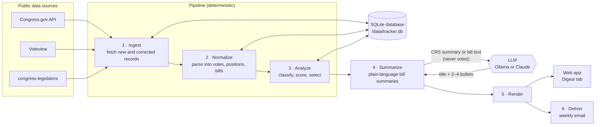

# Legislator Vote Tracker

A self-hosted web app that tracks what your congressional delegation (one U.S. representative and two U.S. senators) did in Congress, week by week. For each member it shows:

- **Breaks from party:** every vote cast against a united caucus.
- **Notable votes:** the highest-scoring votes of the week, with a plain-language summary of each bill.
- **Missed votes:** a count, with high-stakes misses listed individually.
- **Bills introduced and cosponsored** during the week.

Each week opens with **delegation splits**: Senate votes where your two senators voted opposite ways.

You browse any week of the 119th Congress (both chambers) in the web app, and it can email you the previous week's digest every Saturday morning. A Senate item looks like this (illustrative; the bullets come from the summarizer):

> ### Makes continuing appropriations for fiscal year 2026 (H.R. 5371)
> - *(2–4 bullets from the bill summary)*
>
> Summary based on the Congressional Research Service summary · H.R. 5371 on Congress.gov
>
> Vote to end debate on H.R. 5371 (60 votes needed). Passed 60–40.
> Sen. Michael F. Bennet voted Nay, with 39 of 47 Democratic caucus members.
> Nov 10, 2025 · Roll call 617

Fetching, classifying and scoring votes is deterministic code. A language model is used for one job only: describing what a bill does. It never sees how anyone voted. Every sentence about a member's vote is built from the official record by a fixed template.

To work on the code or run the pipeline from the command line, see [DEVELOPMENT.md](DEVELOPMENT.md).

---

## Quick start

### 1. What you need

- **Docker.**
- **A Congress.gov API key.** Get a free key at <https://api.congress.gov/sign-up/>. It is required: House votes, bills and sponsorships all come from Congress.gov.
- **A language model for bill summaries**, one of:
  - [Ollama](https://ollama.com) running on the host (the default). Pull the default model with `ollama pull llama3.1:8b`.
  - An Anthropic API key, to use Claude instead.
- **Optional: a Gmail account** (or any SMTP server) to send the weekly email.

### 2. Build and run

```bash
docker build -t vote-tracker .

docker run -d --name vote-tracker \
  -p 127.0.0.1:8000:8000 \
  -v vote-tracker-data:/data \
  -e CONGRESS_GOV_API_KEY=... \
  -e SMTP_PASSWORD=... \
  --restart unless-stopped \
  vote-tracker
```

Leave out `SMTP_PASSWORD` if you won't send email, and add `-e ANTHROPIC_API_KEY=...` if you'll use Claude for summaries. Secrets are read only from the environment; they never appear in the UI or in the config file. Environment variables are fixed when a container is created, so to add or change one later, remove the container (`docker rm -f vote-tracker`) and run it again with the same volume. Your data and settings are kept.

Open <http://127.0.0.1:8000/>.

### 3. Set it up

On first start the app has no data and tracks Colorado's delegation as an example. Do these once, in order:

1. **Identify yourself to the data sources.** Admin → Settings → HTTP → User agent: replace `you@example.com` with your own contact address. It is sent with every request, so the data providers can reach you if something goes wrong.
2. **Point it at a summarizer.** Admin → Settings → Summaries (LLM):
   - **Ollama on the host:** set Base url to `http://host.docker.internal:11434`. Inside the container, `localhost` is the container itself. This works out of the box with Docker Desktop on macOS and Windows; on Linux, also add `--add-host=host.docker.internal:host-gateway` to `docker run`.
   - **Claude:** set Provider to `anthropic` and Model to `claude-opus-5-5`, and make sure the container was started with `ANTHROPIC_API_KEY`.
3. **Load the member list.** Admin → Data → **Fetch member list**. (When the container starts with an API key it also runs a data update on its own, which loads the list too; the Data card shows what is running.)
4. **Choose your members.** On the Members tab, pick your state, then your representative and two senators, and save. The order matters in one place: delegation splits compare the first two senators.
5. **Load the votes.** Admin → Data → **Backfill from date**, with `2025-01-03` (the start of the 119th Congress). This makes a few thousand Congress.gov requests at one per second, so it takes about an hour. Jobs run one at a time; browsing works meanwhile.
6. **Turn on the weekly email (optional).** Follow [Sending the digest from a Gmail account](#sending-the-digest-from-a-gmail-account), then use "Send last week's digest now" on the Admin tab to test it.
7. **Turn on daily backups (optional).** Follow [Backing up to Dropbox](#backing-up-to-dropbox).

After that, the app keeps itself up to date: it fetches new data daily and, if email is on, sends last week's digest every Saturday. Open the **Digest** tab to read any week.

---

## Using the app

**Digest tab.** Pick any week from the start of the 119th Congress (January 3, 2025) up to last week, which is the default. Arrows step one week at a time, and each week has its own URL (`#/digest/2026-09-14`), so you can bookmark it. Votes show up immediately. Bill summaries are written in the background and fill in as they finish; until then the page shows an excerpt of the official Congressional Research Service (CRS) summary. The week you're viewing gets priority over summaries for other weeks, and while its summaries wait, the page says what they are waiting behind.

**Members tab.** Choose who the digest covers, by state or by name search. Votes for every member of Congress are already stored, so a newly added member's votes appear at once. Saving starts a short background job that fetches the new member's introduced and cosponsored bills.

**Admin tab.**
- **Schedule & email:** whether the weekly email is on, when the next one goes out and which week it covers, the last digest sent, and the next data update. It warns when a setting or secret the schedule needs is missing. "Preview last week's email" opens the exact HTML the email would contain. "Send last week's digest now" is for testing your email settings.
- **Backup:** whether the daily Dropbox backup is on, when the next one runs, and the last one made. "Back up to Dropbox now" uploads one immediately; "Export backup" downloads one; "Import backup…" restores one. See [Backups](#backups).
- **Data:** vote counts, a warning when a chamber's last update failed, and buttons for "Update data", "Backfill from date", "Re-normalize" and "Fetch member list".
- **Jobs:** background jobs with live status, and the history of past runs.
- **Secrets:** whether each one is set; values are never shown.
- **Settings:** every setting, with help text for each. Your changes are checked as you type, problems show under their fields, and Save stays disabled until they are fixed. Email settings are checked for whether they can actually send (a real SMTP host, real From/To addresses rather than the `example.com` placeholders). Settings are saved to `/data/config.toml`; the previous version is kept as `config.toml.bak`.

### Scheduled updates and the weekly email

While the app runs, it does two things on a schedule (three with [backups](#backing-up-to-dropbox)), in the time zone set under Admin → Settings → Digest → Timezone (default `America/Denver`). Both times are editable under Admin → Settings → Schedule.

| Task | Default | Needs |
| --- | --- | --- |
| Data update | Daily at 02:15 (blank turns it off) | `CONGRESS_GOV_API_KEY` |
| Weekly digest email: update, then analyze and summarize last week, then send | Saturday at 07:35 | Email enabled, SMTP settings, `SMTP_PASSWORD` |

Turning on Email → Enabled is all it takes to start getting the digest every week. How it behaves:

- **No surprise sends when you first enable email.** The first email goes out at the next scheduled time, not for one that already passed.
- **Catch-up.** If the app was stopped at the scheduled time, the most recent missed digest is sent when it comes back. Older missed weeks are not.
- **Never twice.** Each emailed week is recorded, including weeks sent with "Send last week's digest now", and is not sent again.
- **One attempt per scheduled time.** A failure, such as a wrong SMTP password, shows on the Admin tab and in the logs instead of retrying. Fix the setting, then use "Send last week's digest now".
- **Nothing runs while the container is stopped.** `--restart unless-stopped` keeps it running across reboots.

### Sending the digest from a Gmail account

Gmail works as the SMTP server. You send from your own Gmail account, usually to yourself.

**1. Create an app password.** Gmail rejects your normal password over SMTP; it needs an *app password*, a separate 16-character password for one app.

1. Turn on [2-Step Verification](https://myaccount.google.com/signinoptions/two-step-verification) for the Google account, if it isn't on already. App passwords require it.
2. Open <https://myaccount.google.com/apppasswords>, create one named, say, "vote-tracker", and copy it. Google shows it only once.

If that page says app passwords aren't available, the account is probably a Google Workspace account whose administrator has turned them off, or it uses Advanced Protection. Use another SMTP provider in that case.

**2. Fill in Admin → Settings → Email:**

| Setting | Value |
| --- | --- |
| Enabled | ✓ |
| Smtp host | `smtp.gmail.com` |
| Smtp port | `587` (STARTTLS, which the tracker uses) |
| Smtp user | your Gmail address, or leave blank to use From addr |
| From addr | your Gmail address. Gmail sends as the account you log in with, whatever this says |
| To addr | where the digest should go, e.g. the same address |

**3. Give the app the app password** as `SMTP_PASSWORD`: re-create the container with `-e SMTP_PASSWORD=abcdefghijklmnop`. Enter the 16 letters without the spaces Google shows between groups of four.

**4. Test it.** On the Admin tab, "Schedule & email" lists any setting that is still missing. Once none are, "Send last week's digest now" sends a test. Its result appears under Data, and an SMTP error appears in `docker logs vote-tracker`. To test with a busier week, send that week from the command line:

```bash
docker exec vote-tracker tracker digest --week 2026-09-14 --send
```

Things to know:

- **Check your spam folder** the first time. Mail an account sends to itself over SMTP sometimes lands there; marking it "Not spam" fixes that.
- **A test send counts as that week's digest,** so the schedule won't send that week again. The next scheduled email covers the following week, so it isn't affected.
- **`535 Username and Password not accepted`** means Gmail rejected the login. Check that `SMTP_PASSWORD` holds the app password (not your account password), that the container was re-created after setting it, and that Smtp user (or From addr) is the account the app password belongs to.
- **Revoking access:** delete the app password on the same Google page. Nothing else on the account changes.

### Backups

A backup is a single zip file holding everything the app keeps: `config.toml` (every setting) and a snapshot of the database (votes, bills, summaries, schedule history). Secrets are never included; they stay in the environment. A backup is consistent even when it is taken while a job is running. A full 119th Congress database compresses to about 20 MB.

- **Export:** Admin → Backup → **Export backup** downloads one, named like `tracker-backup-20261031T093000Z.zip`. It takes a few seconds to start.
- **Daily to Dropbox:** see [Backing up to Dropbox](#backing-up-to-dropbox).
- **Import (restore):** Admin → Backup → **Import backup…**, then choose a backup zip. It replaces all settings and data. Before anything changes, the file is checked: it must be a tracker backup, its settings must be valid, and its database must be intact. If it fails a check, nothing is changed and the reason is shown. The restore then runs as a background job, after any job already running. What it keeps:
  - **The current data and settings, as a fallback.** The database is copied to `tracker.db.before-restore`, and the settings to `config.toml.bak`, next to the originals.
  - **This machine's file locations.** The current `db_path`, `log_dir` and `output_dir` stay as they are, so a backup made outside Docker restores into the container and vice versa.
  - **Backups from older versions.** The database is migrated as on startup.

To restore from Dropbox, download the backup from the Dropbox website or app first, then import it.

### Backing up to Dropbox

While the app runs, it can upload a backup to a Dropbox folder every day (03:30 by default) and delete the oldest ones, keeping the newest 14. You need a Dropbox app of your own, which takes a few minutes to set up once:

**1. Create the app.** At <https://www.dropbox.com/developers/apps>, choose **Create app** → **Scoped access** → **App folder**, and name it, e.g. "vote-tracker-backup" (the name must be unique across Dropbox). With an App folder app, the tracker can only see its own folder, `Apps/<app name>/`.

**2. Grant permissions.** On the app's **Permissions** tab, check `files.metadata.read` and `files.content.write`, then **Submit**. Do this before step 3: a token only carries the permissions the app had when it was issued.

**3. Connect it.** Copy the **App key** from the app's **Settings** tab (the app secret is not needed), then run:

```bash
docker exec -it vote-tracker tracker dropbox-auth --app-key YOUR_APP_KEY
```

(Outside Docker, run `uv run tracker dropbox-auth` instead.) Open the link it prints, click **Allow**, and paste the code Dropbox shows back into the terminal. It prints `DROPBOX_APP_KEY` and `DROPBOX_REFRESH_TOKEN`. The token does not expire; keep it private, like a password.

**4. Give the app the secrets.** Re-create the container with `-e DROPBOX_APP_KEY=… -e DROPBOX_REFRESH_TOKEN=…`.

**5. Turn it on.** Admin → Settings → Backup → Enabled, then Save. The first backup runs right away, and its result appears on the Backup card. After that, one runs every day at the time in Backup → Daily at.

Things to know:

- **Folder.** Dropbox folder (`/vote-tracker` by default) is inside the app folder, so backups land in `Apps/<app name>/vote-tracker/`.
- **Pruning** only ever deletes files named like `tracker-backup-*.zip` in that folder. Deleted backups go to Dropbox's deleted files, where they can be recovered for a while.
- **One attempt per day.** A failed backup shows on the Backup card and in the logs, and is retried at the next daily time. Use "Back up to Dropbox now" after fixing the cause.
- **Revoking access:** remove the app under Dropbox → Settings → Connected apps, or delete it on the developers page.

---

## Running in Docker

The image holds the whole app: the web UI, the API, the background jobs and the scheduler. The container keeps all its state in the `/data` volume (`config.toml`, the `tracker.db` database, rendered digests and logs) and runs as an unprivileged user (uid 1000). Nothing from your working copy's local state goes into the image.

- **Logs** go to `docker logs vote-tracker`, as well as to `/data/logs/tracker.log`.
- **First run.** If `/data/config.toml` doesn't exist, the container creates it from `config.example.toml`.
- **Secrets** are passed as environment variables (`-e`, or `--env-file` with a file only you can read). They are never written to the image or to `/data`.
- **Using existing data.** Bind-mount a folder instead of a named volume, for example `-v "$PWD/tracker-data":/data`, and put a copy of your `tracker.db` and `config.toml` in it. Relative paths in the config (such as `db_path = "./tracker.db"`) resolve inside `/data`. On Linux, the folder must be writable by uid 1000, or add `--user "$(id -u):$(id -g)"`.
- **Upgrading.** Rebuild the image, then remove and re-create the container with the same volume. The database is migrated automatically on startup.
- **Health check.** The image reports healthy once the API answers (`docker inspect -f '{{.State.Health.Status}}' vote-tracker`).
- **Command line.** Every `tracker` command works through `docker exec vote-tracker tracker ...`; see [DEVELOPMENT.md](DEVELOPMENT.md#commands).

### Environment variables

| Variable | Default | Purpose |
| --- | --- | --- |
| `CONGRESS_GOV_API_KEY` | (none) | Required to fetch House votes, bills and sponsorships |
| `ANTHROPIC_API_KEY` | (none) | Only when the LLM provider is `anthropic` |
| `SMTP_PASSWORD` | (none) | Only when email is enabled |
| `DROPBOX_APP_KEY`, `DROPBOX_REFRESH_TOKEN` | (none) | Only for backups to Dropbox; `tracker dropbox-auth` prints both |
| `API_PATH` | `""` (the root) | Path the app is served under behind a reverse proxy, e.g. `/tracker` |
| `TRACKER_ALLOWED_HOSTS` | (none) | Extra `Host` names to accept, comma-separated, e.g. `tracker.example.org`. `localhost` and `127.0.0.1` are always accepted. `*.example.org` and `*` also work |
| `TRACKER_CONFIG` | `/data/config.toml` | Location of the config file |

### Security

The app has no login. It is meant for one person, and anyone who can reach it can change settings, start jobs and send email. Keep the published port bound to `127.0.0.1`, as in the examples. Two guards stop other websites open in your browser from driving it: requests must carry an allowed `Host` header (which blocks DNS rebinding), and every request that changes something must carry a custom header that a cross-site page can't send.

### Behind a reverse proxy

To serve the app at, for example, `https://example.org/tracker/`:

```bash
docker run -d --name vote-tracker \
  -p 127.0.0.1:8000:8000 -v vote-tracker-data:/data \
  -e API_PATH=/tracker -e TRACKER_ALLOWED_HOSTS=example.org \
  -e CONGRESS_GOV_API_KEY=... --restart unless-stopped \
  vote-tracker
```

Point the proxy's `/tracker/` location at `http://127.0.0.1:8000`. In nginx:

```nginx
location /tracker/ {
    proxy_pass http://127.0.0.1:8000;   # no trailing slash: the /tracker/ prefix is passed through
    proxy_set_header Host $host;
    client_max_body_size 1g;            # importing a backup uploads it; nginx's default allows only 1 MB
}
```

- **The `Host` header.** Pass the public host name through (`Host $host` in nginx) and list it in `TRACKER_ALLOWED_HOSTS`. Requests whose `Host` isn't allowed get `400 Invalid host header`. If your proxy rewrites `Host` to the upstream address instead, allow that name, or use `*` as a last resort.
- **Prefix stripping is fine.** If the proxy removes `/tracker` before forwarding, the app still works, because it answers at the root as well. The interactive API docs (`/tracker/docs`) need the prefix passed through.
- **Allow large uploads.** Admin → Backup → Import backup uploads the whole backup (about 20 MB for a full Congress, more over time). nginx rejects request bodies over 1 MB by default with `413 Content Too Large`, so raise `client_max_body_size` as above. Other proxies have their own limits, such as Traefik's buffering middleware or Cloudflare's 100 MB cap on its free plan.
- **Add authentication at the proxy.** Before exposing the app beyond your machine, put HTTP basic auth or your SSO in front of it.

---

## Where the data comes from

| Data | Source |
| --- | --- |
| House votes, bills, CRS summaries, bill text, sponsorships | [Congress.gov API](https://api.congress.gov) |
| Senate votes | [Voteview](https://voteview.com) (default), or senate.gov's official XML |
| Member IDs, party, caucus, leadership roles | [congress-legislators](https://github.com/unitedstates/congress-legislators) |

**Congress.gov rate limits.** A personal key allows about 5,000 requests an hour, and the tracker sends at most one a second. The shared `DEMO_KEY` allows about 10 an hour, which is not enough to use the app.

**Senate votes come from Voteview.** senate.gov's bot protection blocks scripted downloads (`403 Forbidden`), and the tracker doesn't try to get around it. Instead it reads the same roll calls from Voteview, UCLA's roll-call database, which publishes each Congress as CSV files. Everything the tracker uses matches senate.gov on the votes checked, but compared with senate.gov:

- **Vote times** aren't published, only dates, so Senate votes are dated noon Eastern.
- **New votes may appear later.** Voteview is a research database, not an official feed. When checked on 2026-10-24, it ran through the Senate's latest vote.
- **Nomination and amendment numbers** aren't reliable, so the digest shows the nominee description, and amendment votes link to the bill they amend.

Links to Senate roll calls still point to the official senate.gov pages, which open normally in a browser. If senate.gov access is ever granted, set Admin → Settings → Senate votes → Source to `senate_gov`. The digest footer credits Voteview, as its terms ask: Lewis, Jeffrey B., Keith Poole, Howard Rosenthal, Adam Boche, Aaron Rudkin, and Luke Sonnet. *Voteview: Congressional Roll-Call Votes Database.*

**Not covered:** voice votes and unanimous consent, which have no recorded roll call.

---

## How it works



1. **Ingest** fetches new votes, members' bills, and the bills that votes refer to. It also re-fetches the last two weeks of votes to pick up corrections. Every response is stored as received.
2. **Normalize** turns those responses into votes, each member's position, and bills. Each member's caucus is recorded as of the vote's date, so independents who caucus with Democrats are grouped with them.
3. **Analyze** classifies each vote (passage, cloture, amendment, nomination, procedural…), works out the threshold it needed, and finds each caucus's position. It flags party breaks (voting against a caucus that was at least 80% united) and scores the rest: closer votes, more consequential vote types, and bills the member sponsored score higher.
4. **Summarize** asks the language model to describe each selected bill from its CRS summary, or from the bill text when there is no summary yet. Output is validated and cached, so each bill is summarized once.
5. **Render** builds the digest for the web app and the email.
6. **Deliver** emails the digest over SMTP with STARTTLS.

The scheduler runs stages 1–2 daily and all six weekly; opening a week in the web app runs stages 3–4 for it as needed. The scoring weights and thresholds are all settings. For the full rules, see [DEVELOPMENT.md](DEVELOPMENT.md#pipeline-stages).
